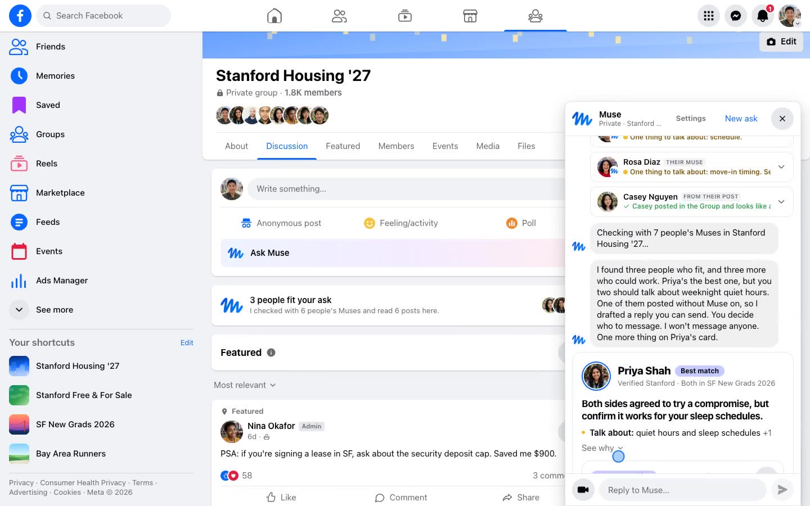
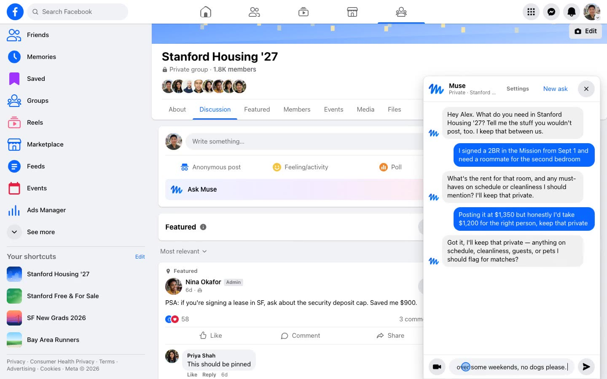
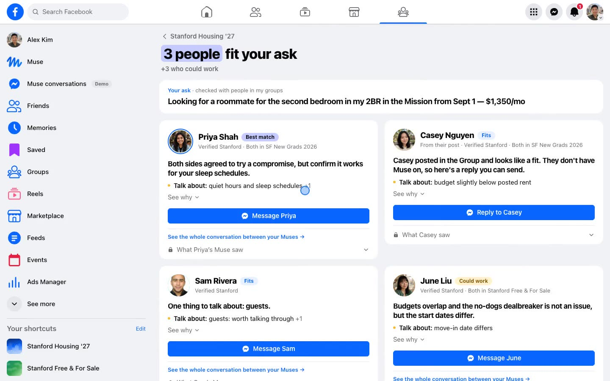
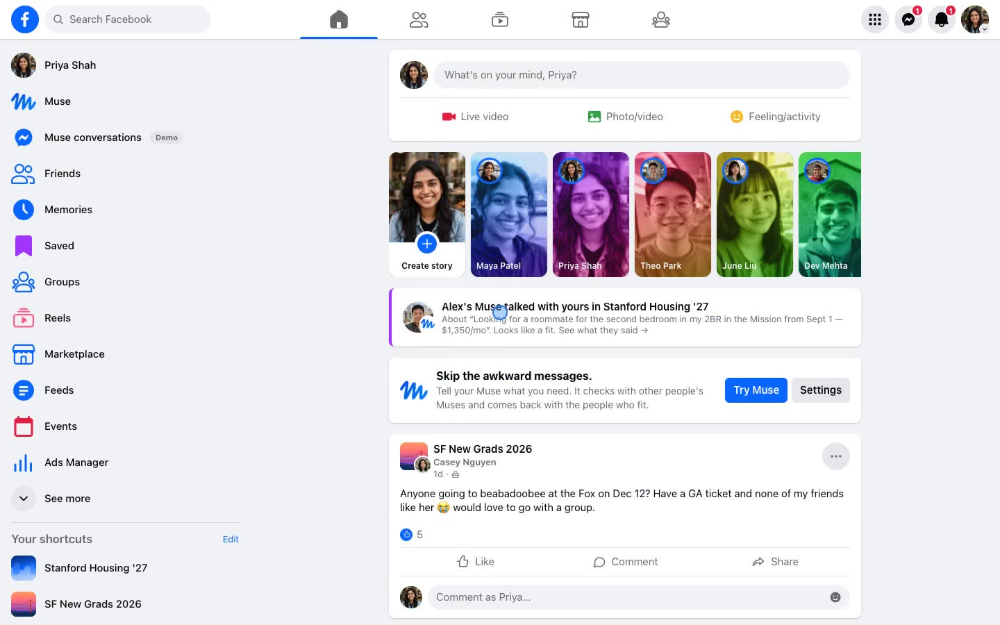
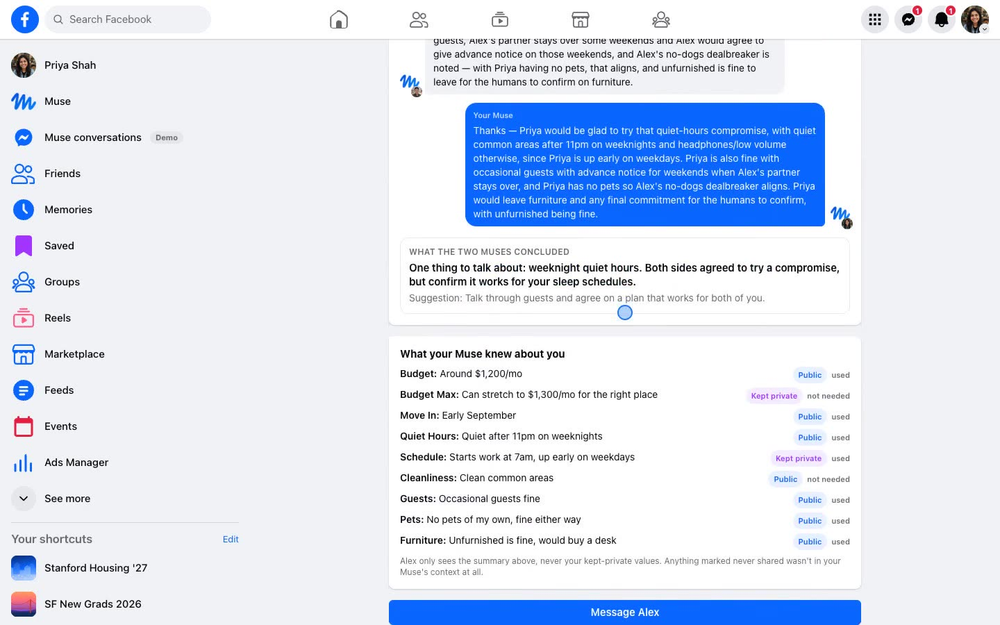
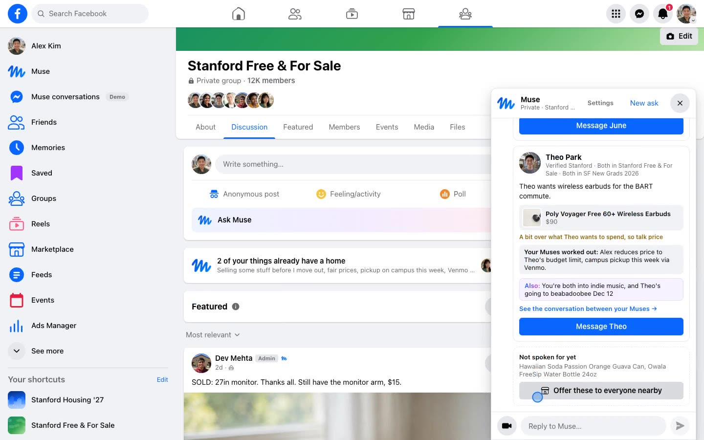
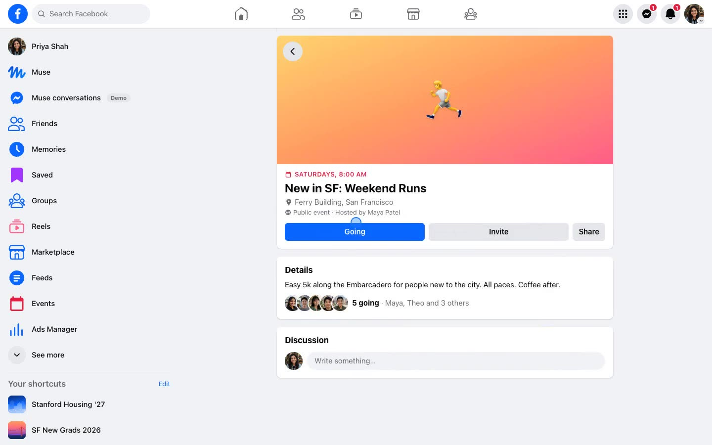

# Mutuals

### Your Muse talks to their Muse, so you only talk to the people who fit.

A new layer for Facebook Groups, built on Meta's Muse models. Tell your Muse what you need, including what you'd
never post. It checks with the Muses of people in your Groups, each one knowing only its own person, and comes back
with **people**, not listings: who fits, why, and the one thing you two should talk about. You decide who to message.

> A marketplace finds you stuff. Your Muse finds you people, and the stuff is just the reason to meet.

Built at the **Facebook Closer Together AI Hackathon 2026** (Meta HQ) by Akhil, Kyle, Luke and Eddy.



**Demo video:** [`docs/video/mutuals-demo.mp4`](docs/video/mutuals-demo.mp4)

**Screen recordings of the real app** (recorded by `npm run clips`, which drives the app in a browser):

| Clip | What happens |
|---|---|
| [Roommate](docs/video/clips/roommate.mp4) (1:25) | Alex asks Muse, seven Muses check, the shortlist, Message Priya, More than a lease, then Priya's side: "Alex's Muse talked with yours", and she joins the weekend run |
| [Selling](docs/video/clips/selling.mp4) (0:35) | A desk video with narration becomes items with exact models, then "2 of these already have a home" |
| [Selling, the other side](docs/video/clips/selling-proof.mp4) (0:12) | June reads the conversation her Muse had with Alex's about the camera |
| [Need a tent](docs/video/clips/tent.mp4) (0:27) | One friend-like question, then Marcus, who has a tent and is driving to Yosemite, plus the carpool |

---

## The problem

Young adults do use Facebook, just not to socialize. We use it to get real things done: a roommate, a sublet, a
buyer for the desk, a ride to SFO. **23% of 18-to-34-year-olds on Facebook use Marketplace every day.** But the part
with other people is miserable. You post your real budget, sleep schedule and dealbreakers to 1,800 strangers, or
you leave out exactly what matters. Then you send "is this still available?" to fifteen people and have the same
screening conversation fifteen times.

Meta has described a Muse network where your Muse works with your friends' and family's Muses. Most young adults
have few Facebook friends. We built the part for **people you haven't met yet**, matched on what people keep private,
inside the Groups they already use.

## What it does

**1. Tell your Muse, not the Group.** Open Muse inside a Group and say what you need in a few lines. Every fact comes
back tagged **Public**, **Kept private** or **Never shared**, and you can change any tag.

**2. Muses talk to Muses.** Say "Yes, check" and your Muse opens a real conversation with the Muse of everyone in
reach who's looking for the same thing, all at once. They work out rent, dates, quiet hours or price and pickup.
Private numbers are compared in code as a yes or no, so nobody's real number crosses over. People without Muse
still count: your Muse reads their Group post and drafts a reply.

**3. You get people, ranked.** Muse speaks first: *"I found three people who fit. Priya's the best one, but you two
should talk about weeknight noise."* Each card shows why they fit, where you'd disagree, a compromise the Muses
already proposed, and trust signals (verified school, shared Groups).

**4. You talk.** Muse never messages a person for you. It drafts an opener with real context, and you hit send in
Messenger.

**5. Sometimes, more than a lease.** When two people share something real and both opted in, Muse suggests an
*activity*, an existing Facebook Event like "New in SF: Weekend Runs". Most matches get nothing. That's the point.

**6. Proof the Muses really talked.** The other person sees "Alex's Muse talked with yours" on their Home and can
read the whole conversation from their side, with the other person's private values shown as "a private number".

| You say | Muse comes back with |
|---|---|
| "I signed a 2BR in the Mission and need a roommate" | Seven Muses checked; Priya is the best fit, Sam fits, Jordan's dog is a dealbreaker that never leaves Alex's side; Priya and Alex both run weekend mornings → New in SF: Weekend Runs |
| "Selling some stuff before I move out" + a phone video, talking over your stuff | Ember hears what you're selling, Spark names each exact model ("this Canon camera" → Canon PowerShot G7 X Mark II). Then "2 of these already have a home": the camera → June (Japan trip), the earbuds → Theo (BART commute), price and pickup already discussed with their Muses |
| "Need a tent for a camping trip" | One friend-like question ("Is this for a trip? Want people to go with?"), then Marcus, who has a tent and is driving to Yosemite Dec 6, plus the carpool |

## Screenshots

| Tell your Muse | People who fit |
|---|---|
|  |  |
| **The other side: "Alex's Muse talked with yours"** | **The Muse-to-Muse conversation, from Priya's side** |
|  |  |
| **Selling: "2 of these already have a home"** | **A roommate search became Saturday plans** |
|  |  |

## Privacy, enforced in code

| Tag | Meaning | Where it's enforced |
|---|---|---|
| **Public** | Can appear on your match card | |
| **Kept private** | Your Muse uses it to check fit. Never shown to the other person. | Prompts are built only from `privacy.agentContext()`. Money is compared in code (`budgetsOverlap`), and every string a human sees goes through `redactPrivateValues()`, which catches rewrites like `$1300`, `1.3k`, `11 pm`. |
| **Never shared** | Never enters any model's context | `agentContext()` drops it before the prompt exists. The model can't leak what it was never given. |

More guards on everything a human sees:
- **Private wording, not just numbers** (`leakedPrivateFacts`): if a model echoes a kept-private fact ("night owl",
  "partner stays over") onto a card or opener, the line is swapped for a topic-level one.
- **Ask titles** (`publicSummary`): the summary Muse writes for your ask is redacted anywhere someone else sees it.
- **Each side is redacted against the other** before anything is stored, streamed or logged.
- **You choose who your Muse can talk to** in Muse settings: people you're connected with, your Groups (default), or
  everyone nearby, with a switch per Group. Every message your Muse sends is logged under **What my Muse shared**.

`src/lib/privacy.test.ts` covers this and stays green.

## How it works

```
Group ─► Muse chat ─► /api/asks (Ember: tagged preferences) ─► /api/media + /api/intake (Ember: frames + narration)
                                                              └► /api/identify (Spark, one call per item, in parallel)
                                     │  Yes, check  (reach: connected · my Groups · everyone nearby)
                                     ▼
                         GET /api/match  (server-sent events, every candidate in parallel)
          ┌──────────────────────────┼──────────────────────────┐
   Muse A ⇄ Muse B, 2 rounds   Muse A ⇄ Muse B, 2 rounds   No Muse: Ember reads their post
   referee verdict             referee verdict             and drafts a reply
          └──────────────────────────┼──────────────────────────┘
                   budgets + move-in dates compared in code · every string redacted
                                     ▼
          connection judgment (only if both opted in) ─► Facebook Event
          shortlist ─► Messenger opener (drafted, you send) ─► "X's Muse talked with yours" for the other person
```

| Job | Model | Why |
|---|---|---|
| Chat, video (frames + narration), both sides of every Muse conversation, referee verdict, connection judgment, routing items to people, openers | **Muse Ember** | Side by side on the same inputs it made the same decisions as Spark and Wonder in about 1 s instead of 10 to 30 s. Checking one person is six calls in sequence, so speed decides whether the live view is watchable. |
| Naming the exact make and model from a photo | **Muse Spark** | The one job where it was clearly better |
| Demo photos | **Muse Image** | Every photo in the seeded feed (`scripts/gen-images.ts`) |

One role map (`modelFor` in `src/lib/muse.ts`) assigns every job. Any role moves with `MUSE_ROLE_<ROLE>=spark|wonder`,
and Wonder calls are time-boxed with an Ember fallback. Every output is validated with zod and cached by input hash.

## Run it

```bash
npm install
cp .env.example .env.local      # add MUSE_API_KEY (base URL https://api.meta.ai/v1)
npm run smoke                   # one tiny call per model: confirms key and model ids
npm run dev                     # http://localhost:3000
```

No key? Everything runs offline with scripted responses:

```bash
echo "MOCK_MUSE=true" > .env.local && npm run dev
```

Switch people from the avatar menu (top right): **Alex** asks, **Priya** sees the other side.

```bash
npm test                        # privacy tests
npm run typecheck
npm run demo                    # the roommate match in the terminal, with a leak check on every human-facing string
npm run demo -- need            # also: plus_one, ride
npm run demo:build && npm run demo:start   # production build for presenting (demo:start:stage adds a human pace)
npm run snapshot -- restore june-room-weekend-runs   # bring back the saved run word for word
npm run clips                   # record the demo clips from the real app (scripts/video/clips.mjs)
```

## Honesty about what's live

Every core step calls the Meta Model API through `src/lib/muse.ts`. Responses are cached by input hash, so a
rehearsed run replays instantly; anything new (a video we haven't seen, a different line) runs live.
`MOCK_MUSE=true` is an offline fallback, and the avatar menu shows which mode you're in. The people, Groups and
their requests are fictional seed data (`seed/`). The data store is a local JSON file, so run it locally.

## Repo

```
src/lib/         muse.ts (model client, role map, cache) · privacy.ts · negotiation.ts · match.ts · connection.ts
                 reach.ts (who your Muse can talk to) · homes.ts (items → people) · identify.ts · intake.ts · media.ts
src/app/         groups/[id] (Group + Muse chat) · groups/[id]/muse/[askId] (people who fit) · muse/talk/[id] (Muse ⇄ Muse)
                 muse/settings · messenger · events · marketplace · notifications · api/*
src/components/  Facebook shell · muse/* (chat, live matching, video capture) · match and connection cards
seed/            people, Groups, posts, events, asks
scripts/         smoke test, terminal demo, cache warmer, snapshots, image generation, video/ (clip recorder)
snapshots/       saved runs (cached responses + demo state)
docs/            PRD.md (spec) · PRESENTATION.md (5-min script) · DEMO.md (runbook) · QA.md · SAVED_RUN.md · VIDEO.md · DEVPOST.md
```

---

*You might have zero mutuals on Facebook today. Mutuals builds them for you.*
