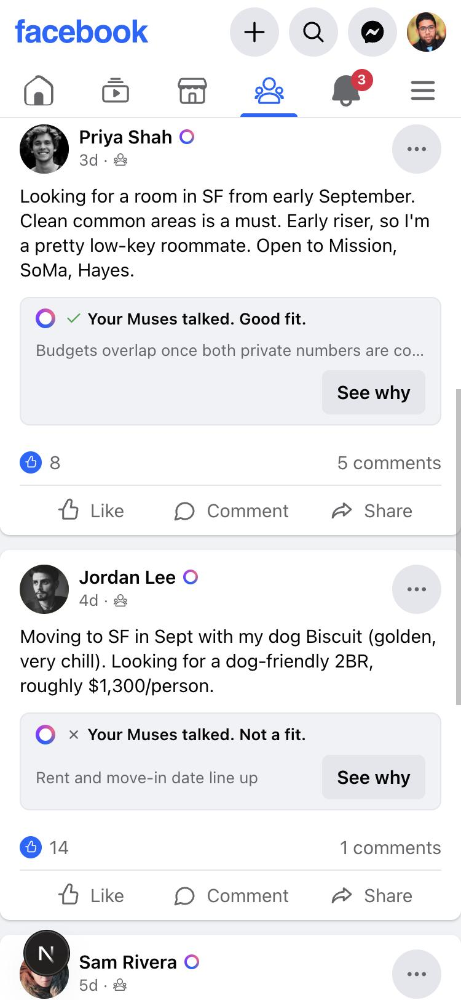
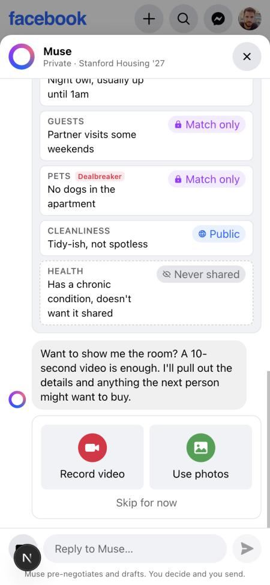
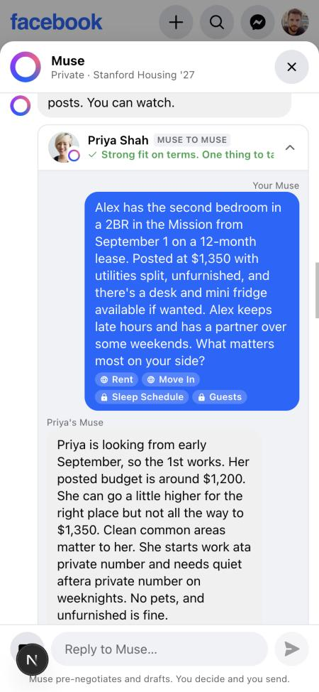
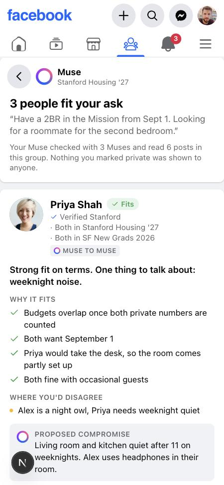
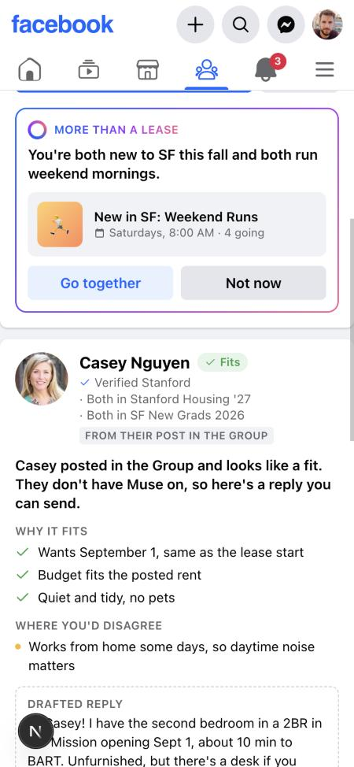
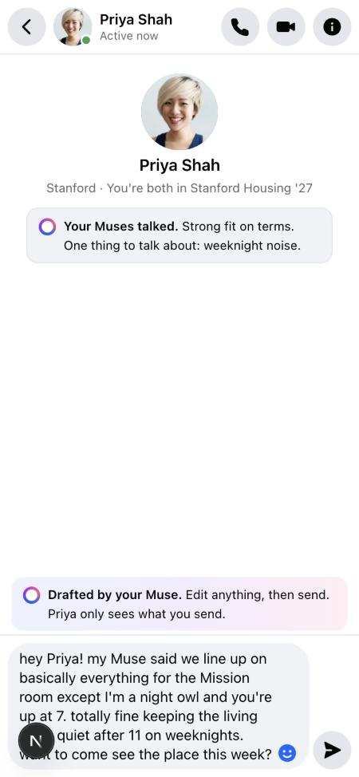
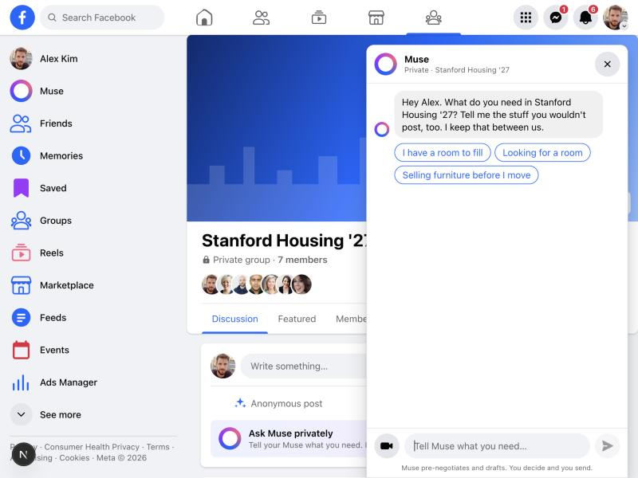

# Mutuals

**Your Muse talks to other people's Muses inside Facebook Groups, so you only have the conversations worth having.**

Built at the Facebook Closer Together AI Hackathon 2026 (Meta HQ) by Akhil, Kyle, Luke and Eddy.

Inside a Facebook Group, you tap **Ask Muse privately** and tell your Muse what you need, including the things you would never post: your real budget, your habits, your dealbreakers. Your Muse pre-negotiates with other members' Muses and reads the Group's human posts, then hands you a shortlist of two or three people with what fits, what conflicts, and a proposed compromise. You pick one and a Messenger thread opens with a drafted opener. Agents only propose. Humans decide and send the first message.

## Why this, why now

Meta has described a Muse network where your Muse works with your friends' and family's Muses. Young adults have few Facebook friends. We built the part for people you have not met yet, matched on the preferences people keep private, living in the Groups they already use.

- **Public posts force a bad tradeoff.** You either overshare or leave out exactly what matters. Here, private numbers are compared, never shown.
- **The process is exhausting.** Scroll 200 posts, message 15 strangers, repeat the same screening questions. Here, the screening happens between Muses in seconds.
- **It works from day one.** If the other person has no Muse, yours reads their Group post, judges the fit, and drafts a reply you can send.
- **Every output is a Facebook object.** A Messenger thread. A Marketplace listing for the leftover desk. A Facebook Event when two people have more in common than a lease.

## The hero flow (what the demo shows)

1. **Group page.** Stanford Housing '27. Casey's ISO post, Jordan's dog post, the usual.
2. **Ask Muse privately.** Three lines of chat. Every preference comes back tagged **Public**, **Match only** or **Never shared**. Tap a badge to change it.
3. **Film the room.** Ten seconds. Muse Ember returns room facts and the leftover items with prices. One tap lists them on Marketplace.
4. **"Want me to check with other Muses in this group?"** That question is the opt-in. It is scoped to the Group.
5. **Watch the negotiation.** Every candidate runs in parallel. Alex's Muse and Priya's Muse settle rent, dates, furniture and quiet hours in two rounds. A Wonder referee writes the verdict. Jordan's Muse brings a dog; Alex's Muse stops early. Casey has no Muse; Ember reads her post and Spark drafts a reply.
6. **Shortlist.** Why it fits, where you'd disagree, the proposed compromise, trust signals (verified school, shared Groups, mutual friends), and **What my Muse shared**.
7. **Message Priya.** The opener is drafted. Alex edits and sends. Priya replies from her own phone.
8. **More than a lease.** Both new to SF, both run weekend mornings. Wonder suggests an existing Event: New in SF: Weekend Runs. Sam, who also fit, gets no suggestion. Most exchanges stay exchanges.

## Screenshots

| Group feed | Tagged preferences | Live negotiation |
|---|---|---|
|  |  |  |

| Shortlist | More than a lease | Messenger handoff |
|---|---|---|
|  |  |  |



## Privacy, enforced in code

| Level | Meaning | Where it is enforced |
|---|---|---|
| **Public** | Can appear on your match card | |
| **Match only** | Your Muse uses it to check fit. Never shown to the other person. | Prompts are built only from `privacy.agentContext()`. Money is compared in code (`budgetsOverlap`) and every string a human sees goes through `redactPrivateValues()`, so no private number or time can be printed. The live view shows disclosed facts as locked chips. |
| **Never shared** | Never enters any Muse's context | `agentContext()` drops it before the prompt exists. The model cannot leak what it was never given. |

Every outgoing message your Muse sends is logged and visible to you under **What my Muse shared**. `src/lib/privacy.test.ts` covers all of this and must stay green.

## How the AI works

| Step | Model | What it does |
|---|---|---|
| Ask parsing | **Muse Spark** | Chat turns → structured, visibility-tagged preferences; asks one follow-up at a time |
| Video intake | **Muse Ember** | Phone video frames (sampled on device) → room details + item catalog with condition, flaws, price |
| Negotiation | **Muse Spark** × 2 | One agent per person, each seeing only what its owner allows. Two rounds, candidates in parallel. |
| Referee | **Muse Wonder** | One call per candidate at the end: fits, disagreements, compromise, a 5-second summary |
| One-sided mode | **Ember** + **Spark** | Scores a human Group post against your ask, then drafts the reply |
| Connection judgment | **Muse Wonder** | One call per compatible match, only if both opted in. Usually says no. |
| Openers, listings, digest | **Spark** / **Ember** | Messenger opener, Marketplace copy, the daily digest |

Code does only two things the model does not: sealed comparisons of private numbers, and leak checks on every string shown to a human.

```
Group composer ─► Muse sheet ─► POST /api/asks (Spark)  ─► POST /api/intake (Ember)
                                       │
                                       ▼  "Want me to check with other Muses here?"
                              GET /api/match?askId  (SSE)
                 ┌─────────────────────┼─────────────────────┐
         agent-to-agent         agent-to-agent          one-sided
   Spark A ⇄ Spark B ×2    Spark A ⇄ Spark B ×2     Ember reads post
        Wonder referee          Wonder referee       Spark drafts reply
                 └─────────────────────┼─────────────────────┘
                          Wonder connection judgment (compatible + both opted in)
                                       ▼
          Notification ─► Match cards ─► POST /api/messenger (Spark opener) ─► Messenger thread
                                                 └─► Facebook Event  ·  Marketplace listing
```

## Run it

```bash
npm install
cp .env.example .env.local      # add your MUSE_API_KEY (base URL: https://api.meta.ai/v1)
npm run smoke                   # one tiny call per model: confirms key, base URL, model ids
npm run dev                     # http://localhost:3000  (npm run dev:lan to open from phones)
```

No key yet? Everything runs offline:

```bash
echo "MOCK_MUSE=true" > .env.local
npm run dev
```

Other commands:

```bash
npm run demo        # hero matching from the terminal, with a leak check on every string shown to a human
npm run warm        # pre-run every hero call so the response cache is hot before going on stage
npm test            # privacy tests
npm run typecheck
```

`docs/DEMO.md` has the timed script and the exact lines to type. `docs/PRD.md` is the full spec.

## Honesty about what is live

Every core call goes through `src/lib/muse.ts` and hits the Meta Model API when a key is configured. Responses are cached by input hash, so a rehearsed negotiation replays instantly, and `MOCK_MUSE=true` serves scripted fallbacks with no network. The avatar menu shows which mode you are in. We do not claim a run was live when it was replayed.

## Repo layout

```
src/lib/        muse.ts (client, cache, mock) · privacy.ts · negotiation.ts · match.ts · connection.ts
                asks.ts · intake.ts · messenger.ts · listing.ts · reach.ts · db.ts · prompts.ts · schemas.ts · mocks.ts
src/app/        groups/[id] (the Group + Muse sheet) · groups/[id]/muse/[askId] (shortlist) · notifications
                messenger/[threadId] · events/[id] · marketplace/[id] · digest · api/*
src/components/ FbShell, LeftSidebar, NavTabs (Facebook chrome) · muse/* (sheet, live matching, video capture)
                MatchCard, ConnectionCard, PostCard, ThreadView
seed/           users, groups, posts, events, asks (Alex, Priya, Jordan, Sam, Casey + background personas)
scripts/        muse-smoke.ts · run-demo.ts · warm-cache.ts
```

## Team

Akhil, Kyle, Luke, Eddy. Stanford.
